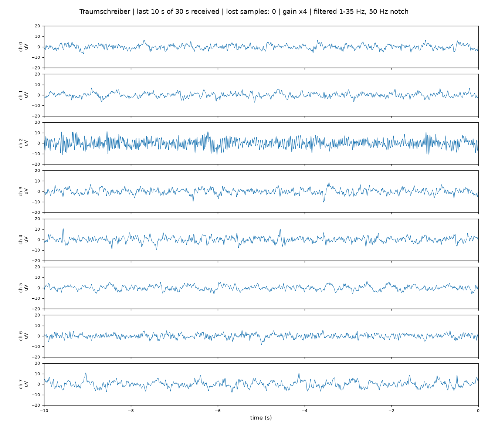

# Traumschreiber BLE live plot

**A single Python script that connects to a
[Traumschreiber](https://github.com/sd20-org/traumschreiber) over Bluetooth and shows all eight
EEG channels live on your computer. No app and no phone needed.**



*Traumschreiber on the forehead with electrodes on channel 2 only; the other seven inputs are
open. Same axis of ±20 µV on all channels, so the EEG stands out from the empty inputs.
Recorded with `python ts_live_plot.py --filter --window 10 --ylim 20`.*

Use it for a quick signal check after putting the electrodes on, for testing the device with a
function generator, or as the starting point for your own experiments in Python. The whole
script is about 200 lines.

| What you see | |
|---|---|
| One plot per channel | in microvolts, the last 5 seconds (adjustable), updated four times per second |
| Title line | device name, seconds shown and received in total, samples lost on the radio link, amplifier gain, filter state |
| Key **f** | switches the display filter on and off: 1–35 Hz band-pass and a notch at the mains frequency (display only) |
| No SD card needed | streaming works with or without a card in the device |

> The Traumschreiber is **not a medical device**, and neither is this script. It is meant for
> education, research and self-observation, not for diagnosing anything.

## Try it

**You need**

- a Traumschreiber,
- a computer with Bluetooth (Linux, macOS or Windows),
- Python 3.9 or newer.

**Steps**

```bash
git clone https://github.com/sd20-org/Traumschreiber_Python_BLE-Live-Plot.git
cd Traumschreiber_Python_BLE-Live-Plot

python3 -m venv .venv
source .venv/bin/activate          # Windows: .venv\Scripts\activate
pip install -r requirements.txt
```

Switch the Traumschreiber on, then:

```bash
python ts_live_plot.py
```

The script searches for 8 seconds, connects to the Traumschreiber with the strongest signal and
opens the plot window. Close the window or press Ctrl+C to stop; the device then stops streaming.

**Options**

| Command | What it does |
|---|---|
| `python ts_live_plot.py` | connect to the nearest Traumschreiber |
| `python ts_live_plot.py --addr AA:BB:CC:DD:EE:FF` | connect to one particular device (the search lists the addresses it finds) |
| `python ts_live_plot.py --filter` | start with the display filter on |
| `python ts_live_plot.py --mains 60` | notch at 60 Hz instead of 50 Hz (Americas, parts of Asia) |
| `python ts_live_plot.py --ylim 50` | fixed axis of ±50 µV instead of automatic scaling |
| `python ts_live_plot.py --window 10` | show the last 10 seconds |
| `python ts_live_plot.py --snapshot 20` | no window: record 20 s, save `ts_live_plot.png`, exit |
| `python ts_live_plot.py --gain 8` | override the amplifier gain (normally read from the device) |

**If something does not work**

| Problem | What to do |
|---|---|
| "No Traumschreiber found" | Switch the device on and keep it close. It connects to one device at a time: close the sd20 app or any other app that may be connected to it. |
| Found, but connecting fails on Linux ("failed to discover services") | Linux may keep a stale entry for the device. Remove it with `bluetoothctl remove AA:BB:CC:DD:EE:FF` (the address the search prints) and start the script again. |
| A channel is a flat line or jumps wildly | That input has no electrode or bad contact. Unused inputs float and show large slow swings. |
| A channel shows a fast, even oscillation | Mains hum (50 or 60 Hz), typical for an open input or a loose electrode. Press **f**: the notch removes it from the display. If it stays, check `--mains`. |
| Many lost samples | Move the computer closer; walls and bodies weaken Bluetooth. Lost samples are still on the device's SD card. |

## How it works

The script has three parts:

1. **Bluetooth** (`ble_main`, runs in a background thread): find the device, read the status,
   subscribe to the data, send the start command.
2. **Decoding** (`parse_packet`): turn each notification into samples in microvolts and count
   gaps in the sample numbers.
3. **Plot** (`update`, called by matplotlib four times per second): draw the newest samples,
   with offset and slow drift removed, optionally filtered.

The device streams on the ExG service `0483ddda-6c9d-6ca9-5d41-03ad4fff4abb`:

| Characteristic | UUID | Use |
|---|---|---|
| Data (notify) | `0483dddb-…` | sample packets, see below |
| Control (write) | `0483dddc-…` | `0x01` start streaming, `0x02` stop |
| Status (read) | `0483dddd-…` | byte 14: number of channels streamed, from byte 15: which channels; further on the amplifier gain |

**Data packet:** one header byte `0xC0`, then any number of samples, each `4 + 8 + 3·n + 4` bytes
for `n` streamed channels (normally 8), little endian:

| Bytes | Field |
|---|---|
| 4 | sample number, +1 per sample |
| 8 | device time in µs |
| 3 × n | channel values, signed 24-bit |
| 4 | status word |

To microvolts: `µV = value × 1.2 V / gain / 2^23 × 10^6`. The sample rate is 250 Hz per channel.
A packet that is only the byte `0xC0` is a keep-alive.

## Related

- [Traumschreiber_Python_Offline-Data-Analysis](https://github.com/sd20-org/Traumschreiber_Python_Offline-Data-Analysis):
  whole nights from the microSD card, with sleep stages and statistics.
- [Traumschreiber_Flutter_Minimal-App](https://github.com/sd20-org/Traumschreiber_Flutter_Minimal-App):
  the same live stream in a small Android app, with spectrogram and sleep staging.

## Contact

Questions or ideas: ts-repo@sd20.org

## Licence

MIT, see [LICENSE](LICENSE).

Made by the [Institute of Sleep and Dream Technologies](https://sd20.org).
